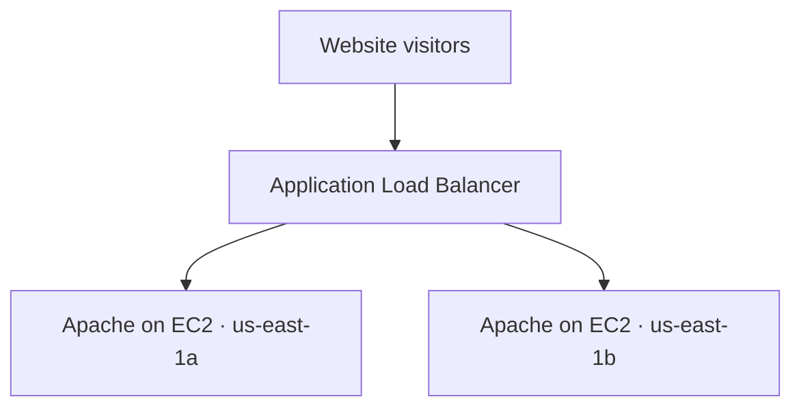

# CloudTech High-Availability Website

AWS portfolio lab that tests how a website behaves when one web server fails.

## Architecture



Terraform created a second public subnet in an existing VPC and deployed an Application Load Balancer and an EC2 Auto Scaling group. The group maintained two Amazon Linux 2023 instances across two Availability Zones. The web servers accepted inbound HTTP only from the load balancer. Administration used AWS Systems Manager Session Manager without opening inbound SSH.

## Failover test

I stopped Apache on one instance while sending repeated requests to the load balancer. Some requests returned `HTTP 502` during the transition, while the surviving server continued to answer requests. Auto Scaling restored two healthy targets across the two Availability Zones. The final 15 requests all returned `HTTP 200`.

## Cleanup

`terraform destroy` removed 12 lab resources. A subsequent `terraform state list` returned no entries.

## Reproduce the lab

Use an existing VPC in `us-east-1` with a public subnet in `us-east-1a`, an available `10.0.1.0/24` range for the second subnet in `us-east-1b`, and a route table with a default route to an internet gateway.

Create a local `terraform.tfvars` file with your own resource IDs:

```hcl
vpc_id                    = "vpc-REPLACE_ME"
existing_public_subnet_id = "subnet-REPLACE_ME"
public_route_table_id     = "rtb-REPLACE_ME"
```

Run `terraform init`, `terraform plan`, and `terraform apply`. Open the URL from `terraform output -raw website_url` after both targets are healthy. To repeat the failover test, send requests to the URL while stopping Apache on one instance through Session Manager. Record the HTTP responses and watch for two healthy targets to return. When finished, review `terraform plan -destroy` before running `terraform destroy`.
